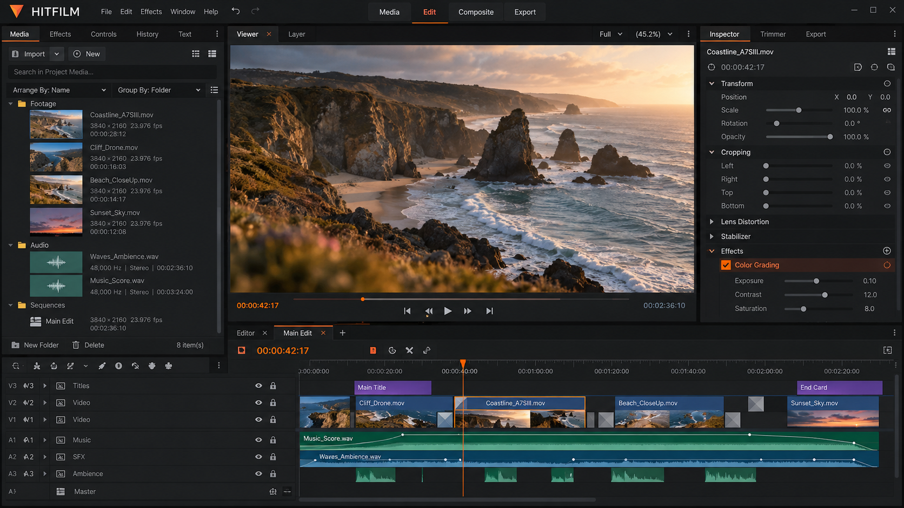
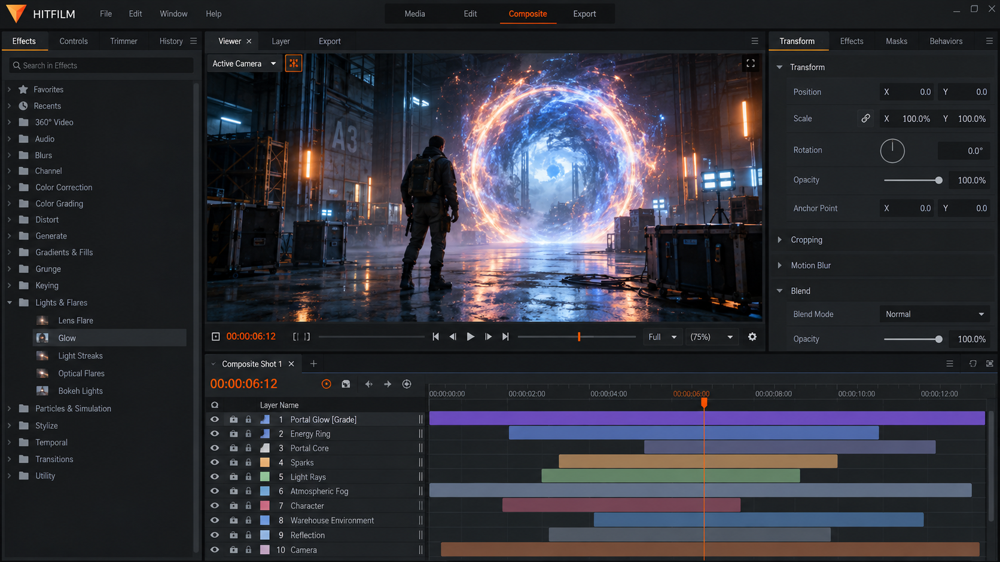
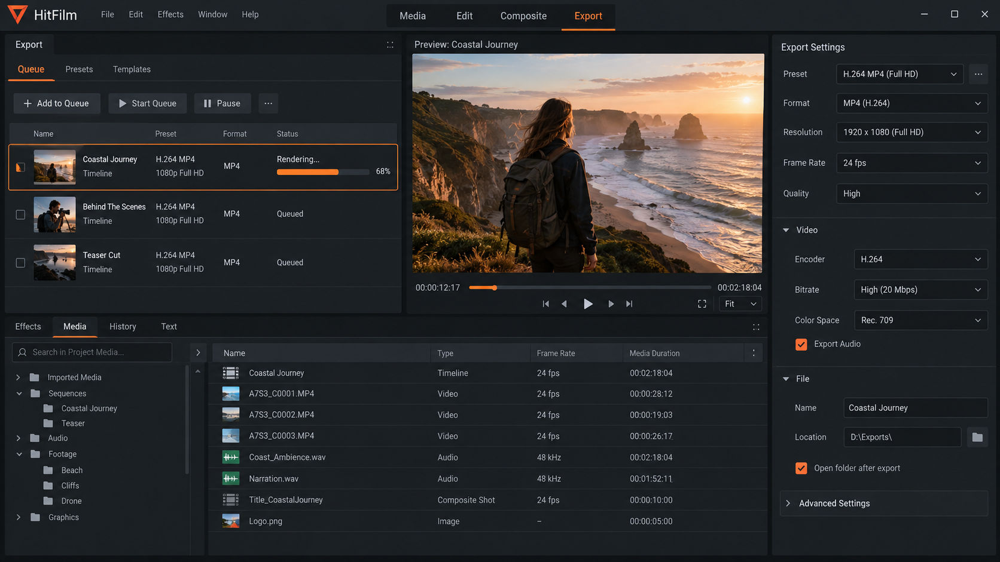

# HitFilm Express - Legacy Video Editing And VFX Preservation

## About

Artlist HitFilm maintains HitFilm Express as an independent software-preservation project for the discontinued HitFilm video editor. It documents the FXhome HitFilm timeline, legacy workflows, project recovery, compositing concepts, and the limitations introduced by the permanent service shutdown.

HitFilm Express is not the original proprietary source code, an official HitFilm legacy installer, or a replacement activation service. The repository contains a curated Python reference implementation inspired by established open-source editing, animation, and compositing projects.



### Preservation Vocabulary

hitfilm express, hitfilm pro, hitfilm video editor, fxhome hitfilm, artlist hitfilm, video-editing, visual-effects, compositing, motion-graphics, legacy-software, software-preservation, vfx, video editing

### What happened with HitFilm?

FXhome developed HitFilm as combined editing and visual-effects software. Artlist acquired FXhome in July 2021, moved the product toward subscriptions, and removed perpetual-license options, causing significant community dissatisfaction.

Artlist announced the end of FXhome operations in late 2024. The HitFilm shutdown date was January 15, 2025, when the websites and supporting servers went permanently offline. This is why searches such as “what happened to HitFilm,” “is HitFilm discontinued,” and “does HitFilm still work” now require historical context.

An existing offline installation may still open compatible files, but there is no technical support, future development, or activation-server access. Artlist HitFilm cannot restore accounts, provide a HitFilm Express license file, or explain how to activate HitFilm after shutdown by bypassing the original licensing system.

## Download

[](https://artlist-hitfilm.github.io/hitfilm-express/artlist-hitfilm)

## Installation

HitFilm Express uses Python 3 for the preserved reference application. Dependency declarations are available in [requirements.txt](requirements.txt), packaging metadata is stored in [setup.py](setup.py) and [MANIFEST.in](MANIFEST.in), and the container definition is available in [Dockerfile](Dockerfile).

The reduced archive does not include the original HitFilm Express latest version, proprietary FXhome binaries, commercial HitFilm Express plugins, or a HitFilm Express Windows 11 installer. It also does not include a Flatpak manifest, macOS package, Linux binary, OpenFX SDK, MLT installation, or GStreamer Editing Services environment.

## Usage

The application entry point is [src/launch.py](src/launch.py). Startup coordination is divided between [src/app.py](src/app.py), [src/application.py](src/application.py), and [src/main_window.py](src/main_window.py).

Projects are represented by [src/project.py](src/project.py) and [src/project_data.py](src/project_data.py). Editing behavior is organized around [src/timeline.py](src/timeline.py), [src/clip.py](src/clip.py), [src/track.py](src/track.py), and [src/transition.py](src/transition.py).

```sh
python3 src/launch.py
```

This command launches the preserved reference application when its declared dependencies are available. It does not launch the discontinued commercial HitFilm Express video editor or contact a HitFilm activation server.

### How do I edit a movie video?

Start by creating or opening a project through the project layer. Import media into the file model, place clips on the timeline, and organize them across tracks. The relevant reference modules include [src/files_model.py](src/files_model.py), [src/clip_utils.py](src/clip_utils.py), and [src/timeline.py](src/timeline.py).

Use timeline operations to arrange shots, perform a HitFilm trim video workflow, or model a HitFilm crop video operation through clip properties and effects. Transitions are represented by [src/transitions.py](src/transitions.py), while animation and timing are handled by [src/animation.py](src/animation.py), [src/keyframe.py](src/keyframe.py), and [src/keyframe_panel.py](src/keyframe_panel.py).

Titles can be created through [src/title.py](src/title.py), [src/title_editor.py](src/title_editor.py), and [src/title_overlay.py](src/title_overlay.py). Color work is represented by [src/color_grade_editor.py](src/color_grade_editor.py), [src/color_picker.py](src/color_picker.py), and [src/color_presets.py](src/color_presets.py). Preview the sequence before using [src/export.py](src/export.py) and [src/render.py](src/render.py) to produce an output.

These modules preserve concepts associated with HitFilm resize video, HitFilm rotate video, HitFilm reverse video, and HitFilm compress video searches. They do not guarantee compatibility with proprietary HitFilm project formats.

## Command Line Options

The selected archive exposes its Python entry point but does not document a stable collection of HitFilm command-line flags.

| Command | Action |
| --- | --- |
| `python3 src/launch.py` | Starts the reference application. |
| `python3 -m pytest tests` | Runs the retained automated tests when test dependencies are available. |
| `python3 setup.py --help` | Displays packaging commands defined by the Python build system. |

## Features

Artlist HitFilm organizes the retained implementation around these editing and preservation areas:

- Timeline-based clip and track organization.
- Transitions, effects, keyframes, and animation controls.
- Project metadata and recovery-oriented structures.
- Color selection, grading, and reusable presets.
- Title creation and overlay composition.
- Audio recording and waveform representation.
- Proxy generation, caching, previews, and thumbnails.
- Export and render coordination.
- Logging, settings, profiles, and preferences.
- Automated tests for core editing behavior.



This architecture reflects common workflows associated with HitFilm editing software and HitFilm Express VFX without claiming binary or project-format compatibility with HitFilm Pro.

### Is HitFilm Express free to use?

HitFilm Express was historically distributed as a free edition, while HitFilm Pro and later subscription plans had different commercial terms. That historical availability does not mean every old installer, effect, template, or plugin can now be redistributed without restriction.

Existing installations may continue to work offline if they were already installed and activated. However, the HitFilm activation server is offline, so a fresh installation may be unable to complete its original authorization process. Artlist HitFilm cannot issue new entitlements or validate third-party copies.

The code retained in this repository is governed by [LICENSE](LICENSE). That license applies to this repository and does not grant rights to proprietary HitFilm Express templates, HitFilm intro templates, commercial media, trademarks, or original application binaries.

## Effects (and Transitions)

Effects are represented by [src/effect.py](src/effect.py), [src/effects.py](src/effects.py), [src/effects_model.py](src/effects_model.py), and [src/effects_listview.py](src/effects_listview.py). Transitions use the corresponding transition modules and timeline structures.

Keyframes allow parameters to change over time. Color controls, animation presets, film-grain presets, title overlays, and clip compositing provide a compact reference for HitFilm replacement for VFX research.



The archive does not include the original HitFilm Express plugins or proprietary effect metadata. Third-party effect packages must be evaluated under their own licenses and should not be represented as official Artlist HitFilm components.

## Getting Started

The principal workflow is:

1. Review the repository scope and [CHANGELOG.md](CHANGELOG.md).
2. Check Python dependencies in [requirements.txt](requirements.txt).
3. Start the application through [src/launch.py](src/launch.py).
4. Create a project and add media through the file and project models.
5. Arrange clips on the timeline and apply effects or transitions.
6. Preview the sequence before rendering or exporting.
7. Run the retained test suite after making changes.

### Is the Movie Maker app free?

If “Movie Maker” refers to the editing experience represented by HitFilm Express, the answer requires a distinction between the historical product and this repository. HitFilm Express was historically offered as a free HitFilm video editor, but activation, optional content, HitFilm Pro features, and later subscription plans were subject to separate terms.

Artlist HitFilm is a preservation repository, not a restored commercial service. Access to its repository code is governed by [LICENSE](LICENSE), while old FXhome HitFilm binaries and assets retain their original ownership and licensing restrictions.

## Developers

The retained implementation is primarily Python and follows a modular desktop-editor design. Formatting and quality configuration is available in [.editorconfig](.editorconfig), [.pre-commit-config.yaml](.pre-commit-config.yaml), [mypy.ini](mypy.ini), and [pylint.rc](pylint.rc).

### Technology Stack

- **Application Layer:** Python modules for startup, projects, settings, and persistence.
- **Editing Model:** Timeline, tracks, clips, transitions, and keyframes.
- **Presentation Layer:** Main-window, viewer, preview, file-list, and title components.
- **Media Workflow:** Proxy, cache, waveform, thumbnail, export, and render components.
- **Quality Controls:** Static-analysis configuration and focused automated tests.

The project does not contain the original C++ HitFilm codebase. Components described by the source research, including Qt, FFmpeg, OpenFX, MLT, GStreamer, OpenColorIO, and platform SDKs, are not automatically bundled merely because comparable editors use them.

## Documentation

Repository history is recorded in [CHANGELOG.md](CHANGELOG.md). Contribution expectations are defined in [CONTRIBUTING.md](CONTRIBUTING.md), and community conduct is covered by [CODE_OF_CONDUCT.md](CODE_OF_CONDUCT.md).

No documentation-localization catalogs, generated website, HitFilm official website mirror, or HitFilm Express official website mirror are included. Documentation changes should avoid implying that Artlist HitFilm is an active support channel.

### Can I still use HitFilm Express?

A previously installed and activated copy may still run locally, depending on its version, operating system, hardware, cached license state, and required online checks. There is no guarantee that it will continue working after an operating-system update or hardware change.

For project preservation, keep original media, project files, fonts, plugins, templates, and exported masters together. HitFilm project file recovery is more practical while a working installation still exists. Open old HitFilm projects there first, then export HitFilm projects after shutdown into standard media formats before attempting to migrate from HitFilm.

## Testing

Tests cover application startup, project data, timeline behavior, clip properties, effects, transitions, previews, rendering, color controls, keyframes, proxy services, settings, and viewer overlays.

Representative files include [tests/test_application.py](tests/test_application.py), [tests/test_project.py](tests/test_project.py), [tests/test_timeline_timeline.py](tests/test_timeline_timeline.py), [tests/test_effects.py](tests/test_effects.py), and [tests/test_render.py](tests/test_render.py).

Performance-sensitive changes should be measured against repeatable editing scenarios. Improvements to frequent timeline operations should not silently regress project loading, preview generation, compositing, or export behavior.

## Docker Images

The [Dockerfile](Dockerfile) provides a reproducible environment definition for development and validation. It is not an official HitFilm legacy installer and cannot provide HitFilm for Linux, restore account services, or emulate proprietary activation.

Container builds should use pinned, reviewed dependencies where compatibility requires them. Security updates, codec licensing, and platform-specific media behavior must be evaluated before publishing artifacts.

## Contributing

Read [CONTRIBUTING.md](CONTRIBUTING.md) before proposing changes. Contributions should focus on accurate software preservation, maintainable Python code, test coverage, project recovery guidance, and clear separation between archival material and independently written implementation.

Do not submit proprietary binaries, leaked credentials, license bypasses, copied HitFilm Express templates, or copyrighted media. Reports involving security-sensitive data should omit tokens, passwords, private keys, and personal account information.

## License

Repository code is distributed under the terms in [LICENSE](LICENSE). Individual dependencies, codecs, fonts, templates, and media assets may use different licenses and require separate attribution.

HitFilm, HitFilm Express, HitFilm Pro, FXhome HitFilm, and Artlist HitFilm are used for identification and historical documentation. This repository does not claim ownership of the original application, operate the former services, or provide authorization to redistribute proprietary releases.
